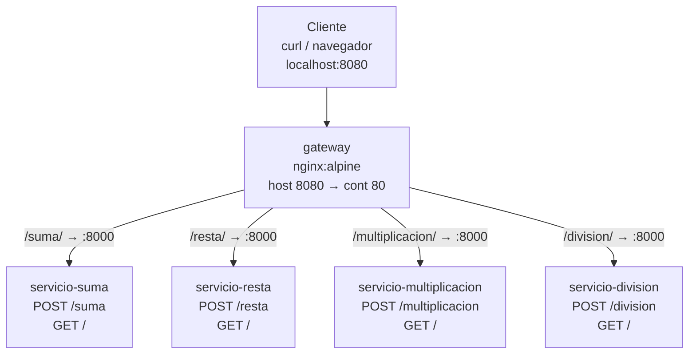

# Microservicios — Calculadora

Calculadora distribuida con 4 microservicios independientes en **FastAPI + Uvicorn**, enrutados por un **API Gateway (Nginx)** con Docker Compose.

## Arquitectura

Flujo: `Cliente → gateway:8080 (host) → nginx:80 (contenedor) → servicio-*:8000` por la red Docker `microservicios_default`. Solo el gateway publica puerto.



| Servicio       | Directorio                 | Endpoint interno       | Vía gateway                                                |
| -------------- | -------------------------- | ---------------------- | ---------------------------------------------------------- |
| suma           | `servicio-suma/`           | `POST /suma`           | `POST http://localhost:8080/suma/suma`                     |
| resta          | `servicio-resta/`          | `POST /resta`          | `POST http://localhost:8080/resta/resta`                   |
| multiplicación | `servicio-multiplicacion/` | `POST /multiplicacion` | `POST http://localhost:8080/multiplicacion/multiplicacion` |
| división       | `servicio-division/`       | `POST /division`       | `POST http://localhost:8080/division/division`             |
| gateway        | `nginx/default.conf`       | —                      | `http://localhost:8080`                                    |

Todos los servicios exponen además `GET /` como healthcheck:
`{"servicio": "<nombre>", "estado": "activo"}`.

Contrato común (request/response JSON):

```json
// POST body
{ "a": 10, "b": 5 }

// POST response
{ "operacion": "suma", "resultado": 15 }
```

La división devuelve `400 {"detail": "No se puede dividir entre cero"}` si `b == 0`.

## Estructura del proyecto

```
microservicios/
├── docker-compose.yml          # Orquesta gateway + 4 servicios
├── nginx/
│   └── default.conf            # Config activa del gateway (montada en /etc/nginx/conf.d/)
├── nginx.conf                  # ⚠️ Obsoleta, no la usa docker-compose (usa nginx/default.conf)
├── servicio-suma/
│   ├── main.py                 # FastAPI: GET / , POST /suma
│   ├── Dockerfile              # python:3.12-slim + uvicorn :8000
│   └── requirements.txt
├── servicio-resta/             # GET / , POST /resta
├── servicio-multiplicacion/   # GET / , POST /multiplicacion
├── servicio-division/          # GET / , POST /division
├── requirements.txt
└── pyproject.toml
```

El gateway hace _strip_ del prefijo gracias a `proxy_pass .../;`:

```nginx
location /suma/ {
    proxy_pass http://servicio-suma:8000/;
}
# /suma/          -> GET http://servicio-suma:8000/  (healthcheck)
# /suma/suma      -> POST http://servicio-suma:8000/suma
```

> Importante: usa siempre el **slash final** en la URL del gateway (`/suma/`, no `/suma`).

## Prerrequisitos

- Docker Engine 24+ y Docker Compose v2 (`docker compose version`)
- `curl` para las pruebas
- Puerto `8080` libre

## Levantar los servicios con Docker

Desde la raíz del proyecto (`/home/harold/TSCC/microservicios`):

```bash
# 1. Construir las imágenes (solo la primera vez o si cambia código/requirements)
docker compose build

# 2. Levantar todo en segundo plano
docker compose up -d

# 3. Verificar que los 5 contenedores estén corriendo
docker compose ps

# 4. Ver logs (todos o uno solo)
docker compose logs -f
docker compose logs -f gateway
docker compose logs -f servicio-suma
```

Salida esperada de `docker compose ps`:

```
NAME                              STATUS
microservicios-gateway-1          Up
microservicios-servicio-suma-1    Up
microservicios-servicio-resta-1    Up
microservicios-servicio-multiplicacion-1 Up
microservicios-servicio-division-1 Up
```

El gateway queda disponible en `http://localhost:8080`.

### Apagar / limpiar

```bash
# Detener contenedores (conserva imágenes)
docker compose stop

# Detener y eliminar contenedores + red
docker compose down

# Limpieza total (contenedores + imágenes construidas)
docker compose down --rmi local
```

## Probar con curl

### 1. Healthchecks (vía gateway)

```bash
curl -s http://localhost:8080/suma/ | jq
# {"servicio":"suma","estado":"activo"}

curl -s http://localhost:8080/resta/ | jq
curl -s http://localhost:8080/multiplicacion/ | jq
curl -s http://localhost:8080/division/ | jq
```

En una línea:

```bash
for s in suma resta multiplicacion division; do echo "== $s =="; curl -s http://localhost:8080/$s/; echo; done
```

### 2. Operaciones (vía gateway)

```bash
# Suma: 10 + 5 = 15
curl -s -X POST http://localhost:8080/suma/suma \
  -H "Content-Type: application/json" \
  -d '{"a": 10, "b": 5}'

# Resta: 10 - 5 = 5
curl -s -X POST http://localhost:8080/resta/resta \
  -H "Content-Type: application/json" \
  -d '{"a": 10, "b": 5}'

# Multiplicación: 10 * 5 = 50
curl -s -X POST http://localhost:8080/multiplicacion/multiplicacion \
  -H "Content-Type: application/json" \
  -d '{"a": 10, "b": 5}'

# División: 10 / 5 = 2
curl -s -X POST http://localhost:8080/division/division \
  -H "Content-Type: application/json" \
  -d '{"a": 10, "b": 5}'

# División entre cero -> 400
curl -s -X POST http://localhost:8080/division/division \
  -H "Content-Type: application/json" \
  -d '{"a": 10, "b": 0}'
# {"detail":"No se puede dividir entre cero"}
```

Con formato legible (requiere `jq`):

```bash
curl -s -X POST http://localhost:8080/suma/suma \
  -H "Content-Type: application/json" \
  -d '{"a": 10, "b": 5}' | jq
```

Script de prueba completa:

```bash
BASE=http://localhost:8080
curl -s -X POST $BASE/suma/suma -H "Content-Type: application/json" -d '{"a":10,"b":5}'; echo
curl -s -X POST $BASE/resta/resta -H "Content-Type: application/json" -d '{"a":10,"b":5}'; echo
curl -s -X POST $BASE/multiplicacion/multiplicacion -H "Content-Type: application/json" -d '{"a":10,"b":5}'; echo
curl -s -X POST $BASE/division/division -H "Content-Type: application/json" -d '{"a":10,"b":5}'; echo
```

Resultados esperados:

| Petición                                             | Respuesta                                         |
| ---------------------------------------------------- | ------------------------------------------------- |
| `POST /suma/suma {"a":10,"b":5}`                     | `{"operacion":"suma","resultado":15.0}`           |
| `POST /resta/resta {"a":10,"b":5}`                   | `{"operacion":"resta","resultado":5.0}`           |
| `POST /multiplicacion/multiplicacion {"a":10,"b":5}` | `{"operacion":"multiplicacion","resultado":50.0}` |
| `POST /division/division {"a":10,"b":5}`             | `{"operacion":"division","resultado":2.0}`        |

### 3. Documentación interactiva (Swagger)

Cada servicio expone Swagger en `/docs`, pero solo el puerto `8080` está publicado. Para acceder directo, levanta un puerto temporal o corre el servicio local (ver abajo). Ejemplo local:

```bash
uvicorn main:app --port 8001 --app-dir servicio-suma
# http://localhost:8001/docs
```

## Desarrollo local sin Docker (opcional)

```bash
pip install -r requirements.txt

uvicorn main:app --port 8001 --app-dir servicio-suma &
uvicorn main:app --port 8002 --app-dir servicio-resta &
uvicorn main:app --port 8003 --app-dir servicio-multiplicacion &
uvicorn main:app --port 8004 --app-dir servicio-division &

curl -s -X POST http://localhost:8001/suma -H "Content-Type: application/json" -d '{"a":2,"b":3}'
```

## Notas / problemas conocidos

1. **`servicio-division/main.py:18` tiene un bug**: hace `datos.a + datos.b` en lugar de `datos.a / datos.b`. Corregirlo a:
   ```python
   return {"operacion": "division", "resultado": datos.a / datos.b}
   ```
2. **`nginx.conf` (raíz) está obsoleta**: escucha en `8080` y apunta a `127.0.0.1:8001-8004`. La config real usada por Compose es `nginx/default.conf` (escucha en `80` dentro del contenedor, usa nombres de servicio Docker como `http://servicio-suma:8000`).
3. **`docker-compose.yml` declara `version: "3.9"`**, obsoleto en Compose v2 (solo genera un warning, funciona igual).
